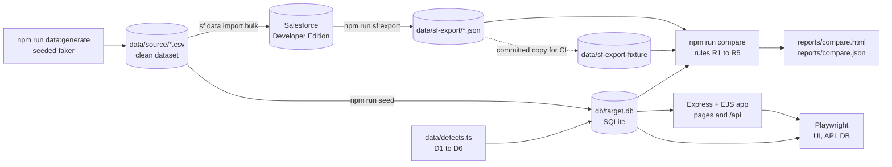
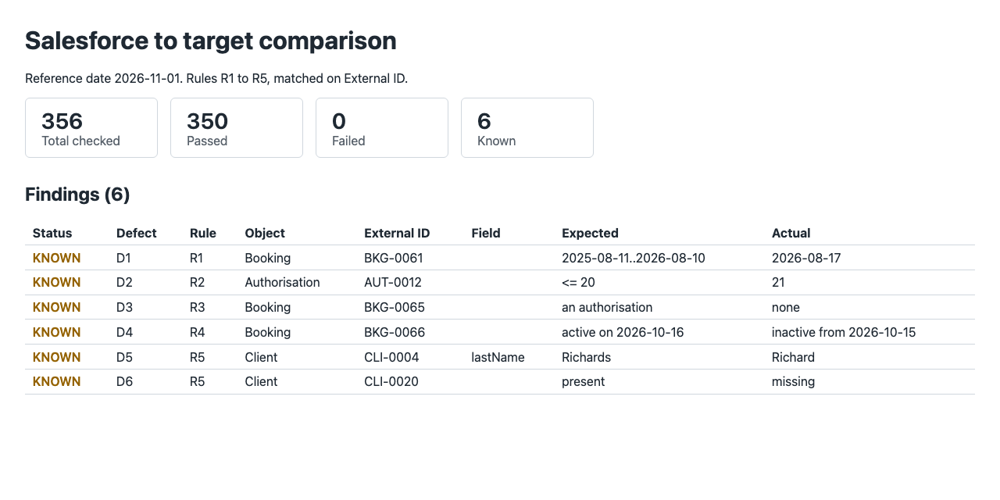
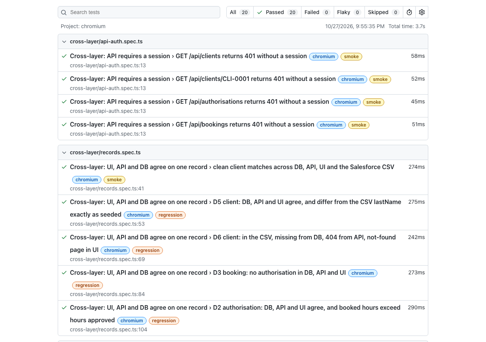

# migration-qa-toolkit

[](https://github.com/leontran371-hub/migration-qa-toolkit/actions/workflows/ci.yml)

A healthcare services company is moving its booking and billing data from Salesforce to a custom system. While both run side by side, this toolkit proves the data still matches. It generates one seeded, fake dataset and loads it into a real Salesforce Developer Edition org and into the target system's SQLite database, with six documented defects planted only in the target. It then checks five business rules with a deterministic comparison engine and tests the target app through its UI, its JSON API and its database in the same flow, on every push in GitHub Actions. All data is fake.

## Architecture



## Quick start

Needs Node 22 (`.nvmrc`). No Salesforce login is needed: the compare step uses the committed export.

```bash
git clone https://github.com/leontran371-hub/migration-qa-toolkit.git && cd migration-qa-toolkit
nvm use && npm ci && npx playwright install chromium
npm run data:generate && npm run seed
npm test && npm run compare -- --source data/sf-export-fixture --known docs/known-defects.json
npx playwright test
```

Open the reports at `reports/compare.html` and `npx playwright show-report`. To see the app, run `npm start` and sign in at http://localhost:3000 with the test user from `.env.example` (copy it to `.env` to change the values).

With your own Developer Edition org logged in as `qa-dev`: `npm run sf:deploy`, `npm run sf:load`, `npm run sf:export`, then `npm run compare -- --known docs/known-defects.json`. `npm run sf:reset` deletes the records so the load can be repeated.

## Test plan

### Scope

Objects: Client, Practitioner, Funder, Authorisation, Case (Service Case in Salesforce) and Booking. Every record has an External ID shared by both systems (`CLI-0001`, `PRA-0001`, `FUN-0001`, `AUT-0001`, `CAS-0001`, `BKG-0001`).

| Rule | Check |
|---|---|
| R1 | A booking's date falls within its authorisation's start and end dates. |
| R2 | The sum of booking hours on an authorisation never exceeds the hours approved. |
| R3 | Every booking has an authorisation. |
| R4 | A booking's practitioner is active on the booking date. |
| R5 | Every Salesforce record exists in the target, with every field matching. |

All date logic uses a fixed `REFERENCE_DATE` (default 2026-11-01), never the real clock, so every run gives the same result.

### Approach per layer

| Layer | Tool | What it proves | Tests |
|---|---|---|---|
| Rules | Vitest | Each rule R1 to R5 has a pass case and a fail case; known-defect matching and the summary counts. | 18 |
| Data | `npm run compare` | Salesforce export vs target DB, matched on External ID. Reports exactly D1 to D6 and nothing else: 356 checks, 350 passed, 6 known. Exits 1 on any unknown finding. | 356 checks |
| UI | Playwright, page objects | Login, invalid login, logout, client search, client detail fields, and the defective bookings on the booking pages. | 11 |
| API + DB + UI | Playwright, API and SQLite helpers | One record per test checked through the UI, the API and the database (clean client, D2, D3, D5, D6), plus 401 on every endpoint without a session. | 9 |

Playwright tests are tagged `@smoke` (8) or `@regression` (12); `npx playwright test --grep @smoke` runs the smoke set. Each worker logs in once and reuses the saved session. Traces and screenshots are kept on failure. There are no fixed waits.

### Risks

| Risk | Mitigation |
|---|---|
| Test data drifts between runs, so results can't be compared. | Fixed faker seed and `REFERENCE_DATE`; CSV checksums are identical across runs. |
| A defect in the target hides behind a matching record count. | R5 compares every field, not just counts. |
| A real defect is waved through as "known". | `--known` matches on rule, object, External ID and field; any other finding fails the build. |
| CI can't reach Salesforce. | CI compares against a committed export of the org (`data/sf-export-fixture`). |
| Flaky UI tests erode trust. | Web-first assertions only, role/label/test-id locators, `--repeat-each=3` passes with no flakes. |

### Out of scope, and why

- **Writing back to Salesforce from the target**: the migration is one-way during the transition.
- **Performance and volume**: the dataset is 133 records. The aim is correctness of the checks, not load.
- **Live Salesforce in CI**: it would need org credentials in CI. The committed export keeps CI self-contained.
- **Security testing beyond auth**: the app is a local stand-in for the target system. Only login and 401 handling are tested.
- **Cross-browser runs**: Chromium only, to keep the suite fast and focused on data checks.
- **Cases in the rules**: no business rule covers Case; Cases are covered by R5 field matching only.

## Seeded defects

Applied only to the target, on top of the clean data. Full detail in [docs/seeded-defects.md](docs/seeded-defects.md).

| Defect | Rule | External IDs | What changed |
|---|---|---|---|
| D1 | R1 | BKG-0061 on AUT-0001 | Booking dated 2026-08-17, after the authorisation ended on 2026-08-10. |
| D2 | R2 | BKG-0062, BKG-0063, BKG-0064 on AUT-0012 | Three 5-hour bookings take booked hours to 21 of 20 approved. |
| D3 | R3 | BKG-0065 | Booking with no authorisation. |
| D4 | R4 | BKG-0066 with PRA-0005 | Booking on 2026-10-16; the practitioner is inactive from 2026-10-15. |
| D5 | R5 | CLI-0004 | Last name "Richards" became "Richard". |
| D6 | R5 | CLI-0020 | Client exists in Salesforce but is missing from the target. |

## Reports

Compare report:



Playwright report:



## What I'd do next

- Compare Salesforce and the target directly through their APIs on a schedule, instead of a one-off export.
- Add a reverse R5 check that flags target-only records, with an allow-list for records created after cut-over.
- Grow the dataset with a volume profile and time the compare run.
- Publish the reports to GitHub Pages so reviewers don't need to download artifacts.
- Add Case rules (for example, no bookings for a client after their case closes) once the business confirms them.

Decisions made along the way are logged in [docs/decisions.md](docs/decisions.md).
